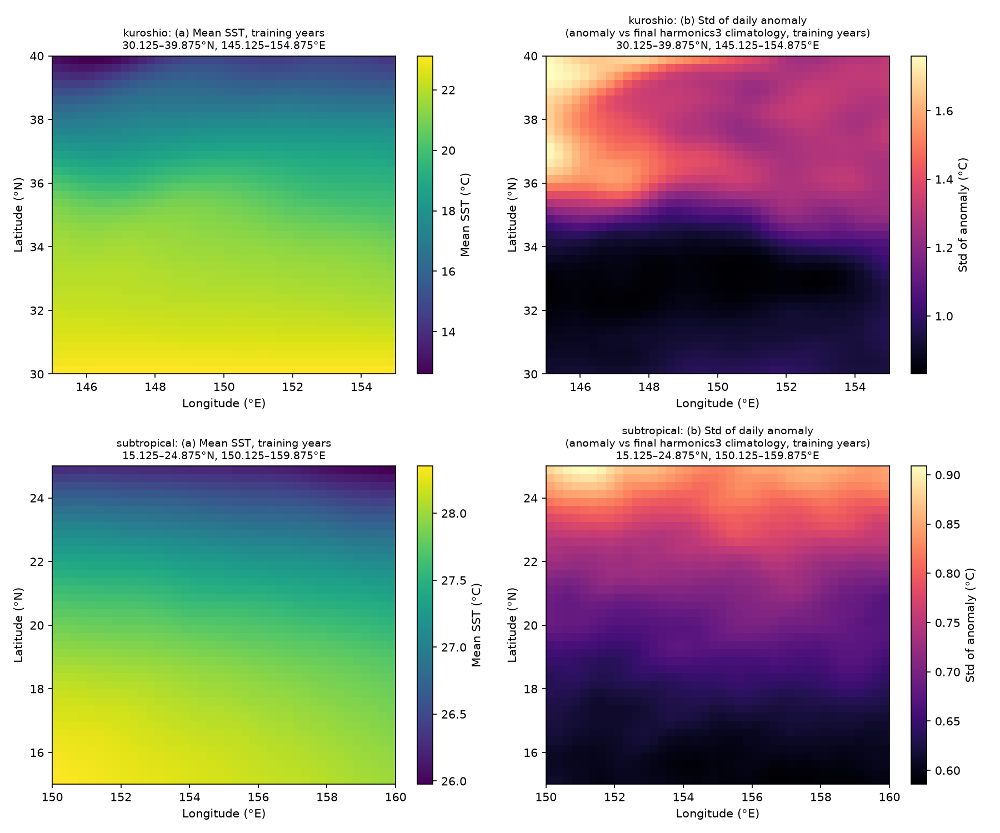
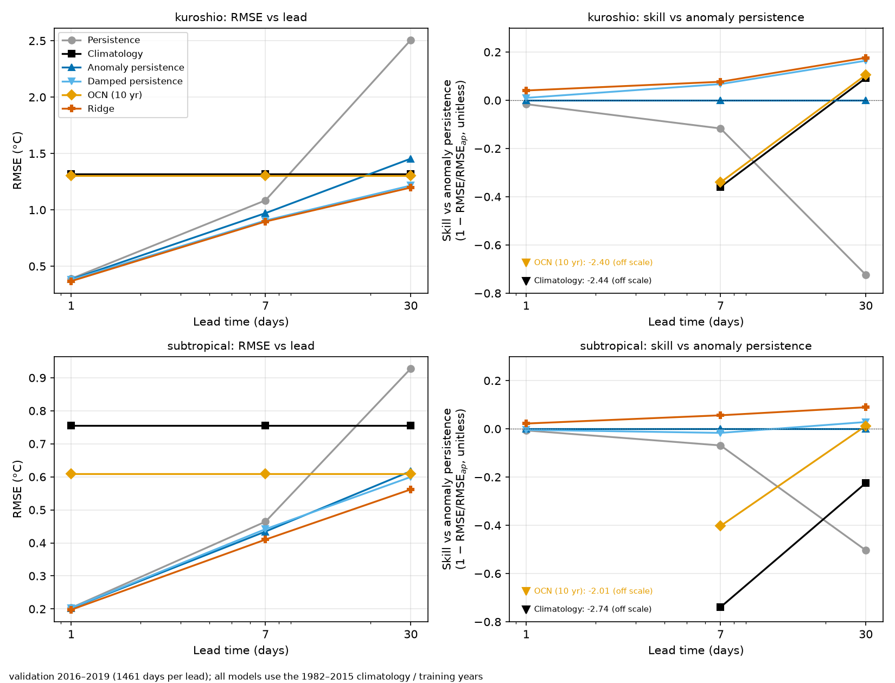
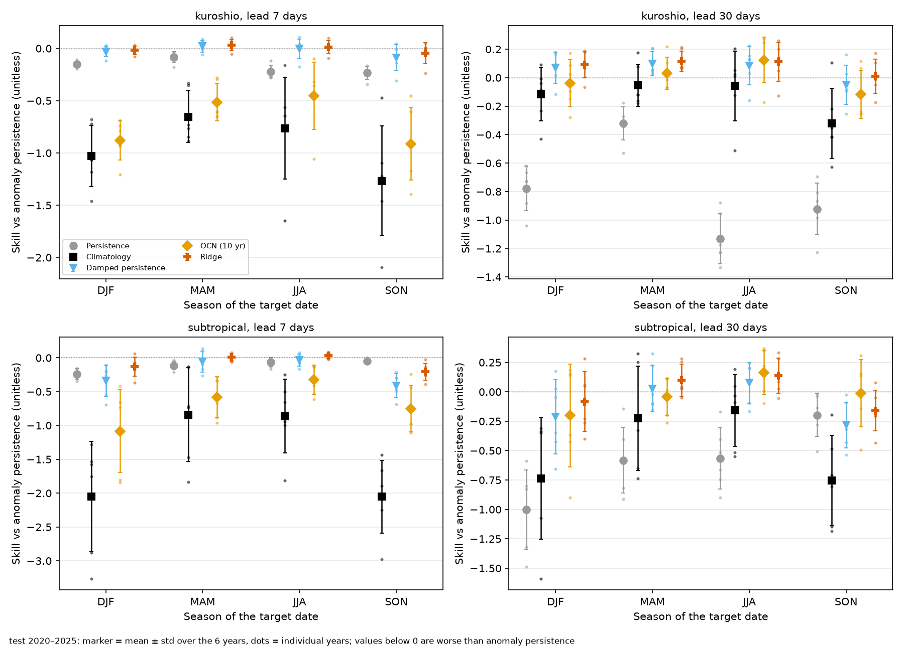
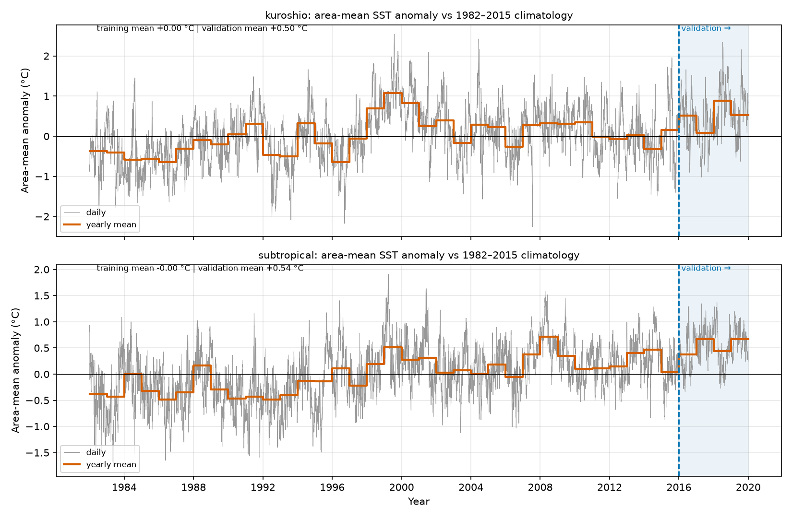
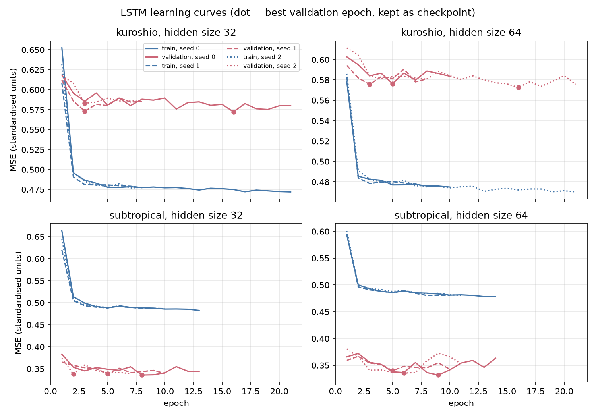

# sst-baselines

**Baselines and a reproducible evaluation for short-range sea-surface-temperature (SST) forecasts in two small North Pacific regions.** Six simple methods (persistence, climatology, anomaly persistence, damped persistence, optimal climate normals, per-grid-point Ridge regression) are compared at 1, 7 and 30 days with a fixed, pre-registered protocol: training 1982–2015, validation 2016–2019, test 2020–2025 evaluated once. This is **not** an ocean forecasting model; it is a study of how hard simple baselines are to beat.

## Purpose
Know the strength of simple baselines before any learned model is compared with them. Two 10°×10° boxes: a high-variability Kuroshio-extension box (30.125–39.875°N, 145.125–154.875°E; per-point anomaly std 1.13 °C) and a low-variability subtropical box (15.125–24.875°N, 150.125–159.875°E; 0.69 °C), per-point std of the daily anomaly vs the final training climatology (1982–2015, `results/region_stats.json`).

## Data
- **Primary: ERDDAP** `ncdcOisst21Agg` (NOAA OISST v2.1 final, daily, 0.25°, variable `sst`) – 14,877 days per region.
- **Gap fill: NOAA PSL OPeNDAP** (`noaa.oisst.v2.highres`, `sst.day.mean.{year}.nc`) – only for the 1,194 days per region that the ERDDAP aggregation lacks (mostly 1992–1998; visible in the server's own time axis, copied to `results/erddap_time_axis.csv`). Checks: every gap month fetched twice and identical, in range, plausible day-to-day, and matching ERDDAP on all overlap days (154/154 pieces, 24/24 region-years, max |difference| 3.8e-06 °C, tolerance 1e-05). Nothing is interpolated; the source of every day is stored in `data/processed/<region>.nc` (`source`).
- **Data are not included in this repository.** `data/` (raw downloads, the merged `data/processed/*.nc`) is gitignored and is regenerated by the scripts under *Reproduce*; only the small time-axis file and the QC / validation JSON files are kept in `results/`.
- Result: **16,071 daily fields per region** (1982-01-01 … 2025-12-31), 40x40 grid, no missing day, no land point.
- Downloaded on 2026-11-02 (ERDDAP primary; PSL for gap days).
- Split (`config.yaml`): training 1982–2015, validation 2016–2019, test 2020–2025.

## Data notes
- **1996 cold event (kept unchanged):** the record minimum of the Kuroshio box, −1.14 °C, is on 1996-03-30 at 39.875°N, 146.375°E (PSL gap fill; the neighbouring days come from ERDDAP and agree). Not a download or processing artefact (two sources agree, smooth for ~10 days, spatially coherent), but extreme for the region in March (~8 °C below the local mean) and possibly a feature of the AVHRR-only analysis of that era. It lies in the training period.
- **v2 / v2.1 label at 2016:** PSL labels its files OISST v2 up to 2015 and v2.1 from 2016 – the year the validation period starts. 56 single-day samples from both label periods match ERDDAP v2.1 (max |difference| 1.9e-06 °C, `results/psl_version_samples.json`); no numerical difference was seen at 2016.

## Protocol (fixed before looking at validation or test scores)
- Leads h = 1, 7, 30 days; target = SST at t+h, issued on day t using data at or before t.
- Climatology: day-of-year mean over training years only, smoothed with 3 annual harmonics (Feb 29 uses Feb 28); anomaly = SST − climatology.
- Scores with cos(latitude) weights: RMSE, MAE, ACC (primary: temporal per grid point; secondary: daily spatial), skill = 1 − RMSE/RMSE_reference (references: anomaly persistence = primary, climatology), by season and by year. Pairs with a missing input/target day are skipped and counted (0 skipped in the test period).
- Ridge alpha chosen on validation RMSE only; the final Ridge model is fitted on training years only with that alpha (no refit on validation).
- The test period was evaluated **once**, after the configuration was frozen and tagged (`pre-test-freeze`); `sst.run_test` refuses to run otherwise.

## Baselines
| name | forecast for t+h |
|---|---|
| persistence | SST(t) |
| climatology | climatology(t+h) |
| anomaly persistence | climatology(t+h) + anomaly(t) |
| damped persistence | climatology(t+h) + r(h)·anomaly(t), r(h) per grid point from training years |
| OCN | mean of the same calendar day over the previous 10 years (all before the issue date) |
| Ridge | climatology(t+h) + Ridge(anomaly lags 0–6 and mean anomaly t−29..t); one model per grid point and lead; features standardised with training statistics; alpha from a 13-value log grid 1e-3…1e3, one alpha per region and lead |

Chosen Ridge alphas (validation): kuroshio: 1 d = 0.00316, 7 d = 0.001, 30 d = 0.001; subtropical: 1 d = 0.01, 7 d = 0.001, 30 d = 0.001.

**How each baseline is calculated:** [`report/methods_note.pdf`](report/methods_note.pdf) (exact formulas, every choice explained, and a worked numeric example from the real data; source `report/methods_note.md`).

## Results
Cells: RMSE in °C (skill vs anomaly persistence, unitless; 0 for anomaly persistence by definition). Validation = 2016–2019 (1461 days per lead), test = 2020–2025 (2192 days per lead). Full scores (MAE, ACC, skill vs climatology, by season and year) are in `results/val_all.json` and `results/test_all.json`; bias in `results/val_bias.json` and `results/test_bias.json`.

**kuroshio**

| Method | Val 1 d | Val 7 d | Val 30 d | Test 1 d | Test 7 d | Test 30 d |
|---|---|---|---|---|---|---|
| Persistence | 0.390 (-0.016) | 1.084 (-0.117) | 2.507 (-0.724) | 0.268 (-0.039) | 0.983 (-0.166) | 2.554 (-0.817) |
| Climatology | 1.320 (-2.443) | 1.320 (-0.359) | 1.320 (+0.092) | 1.591 (-5.174) | 1.591 (-0.886) | 1.591 (-0.132) |
| Anomaly persistence | 0.383 (+0.000) | 0.971 (+0.000) | 1.454 (+0.000) | 0.258 (+0.000) | 0.843 (+0.000) | 1.405 (+0.000) |
| Damped persistence | 0.380 (+0.010) | 0.906 (+0.067) | 1.216 (+0.164) | 0.262 (-0.017) | 0.854 (-0.012) | 1.324 (+0.058) |
| OCN (10 yr) | 1.302 (-2.395) | 1.302 (-0.341) | 1.302 (+0.105) | 1.390 (-4.394) | 1.390 (-0.648) | 1.390 (+0.011) |
| Ridge | 0.368 (+0.041) | 0.896 (+0.077) | 1.198 (+0.176) | 0.251 (+0.025) | 0.838 (+0.007) | 1.281 (+0.088) |

**subtropical**

| Method | Val 1 d | Val 7 d | Val 30 d | Test 1 d | Test 7 d | Test 30 d |
|---|---|---|---|---|---|---|
| Persistence | 0.203 (-0.007) | 0.464 (-0.069) | 0.928 (-0.504) | 0.124 (-0.019) | 0.391 (-0.110) | 0.913 (-0.597) |
| Climatology | 0.756 (-2.738) | 0.756 (-0.739) | 0.756 (-0.225) | 0.846 (-5.955) | 0.846 (-1.399) | 0.846 (-0.480) |
| Anomaly persistence | 0.202 (+0.000) | 0.434 (+0.000) | 0.617 (+0.000) | 0.122 (+0.000) | 0.353 (+0.000) | 0.571 (+0.000) |
| Damped persistence | 0.203 (-0.004) | 0.442 (-0.017) | 0.600 (+0.028) | 0.135 (-0.109) | 0.415 (-0.178) | 0.623 (-0.091) |
| OCN (10 yr) | 0.609 (-2.015) | 0.609 (-0.403) | 0.609 (+0.012) | 0.595 (-3.890) | 0.595 (-0.687) | 0.595 (-0.041) |
| Ridge | 0.198 (+0.022) | 0.410 (+0.056) | 0.562 (+0.090) | 0.128 (-0.049) | 0.370 (-0.049) | 0.568 (+0.006) |

**Key findings (test)**

1. **Anomaly persistence is the bar to beat, especially at short range.** Its 1-day RMSE is 0.122 °C (subtropical) and 0.258 °C (Kuroshio), while climatology gives 0.846 and 1.591 °C and OCN 0.595 and 1.390 °C. Ridge's margin over anomaly persistence at 1 day is small (skill +0.025 Kuroshio, -0.049 subtropical).
2. **Ridge helps in the high-variability Kuroshio box, not reliably in the subtropical box.** Kuroshio: Ridge beats anomaly persistence at every lead (skill +0.025, +0.007, +0.088 at 1, 7, 30 d). Subtropical: Ridge is worse at 1 and 7 days (-0.049, -0.049) and about equal at 30 d (+0.006).
3. **Plain persistence fails at 30 days, and the warm shift hurts climatology-based forecasts.** Persistence at 30 d has skill -0.817 (Kuroshio) and -0.597 (subtropical) relative to anomaly persistence. Against the 1982–2015 climatology the test years are warm: mean bias of the climatology forecast is -0.827 °C (Kuroshio) and -0.656 °C (subtropical); Ridge at 30 d is also biased low (-0.442, -0.287 °C).
4. **The ranking changed between validation and test.** Methods that relax towards the 1982–2015 climatology (Ridge, damped persistence) beat anomaly persistence on validation but lost much or all of that advantage on test. Skill vs anomaly persistence at 1, 7, 30 d, validation → test: Ridge Kuroshio +0.041, +0.077, +0.176 → +0.025, +0.007, +0.088; Ridge subtropical +0.022, +0.056, +0.090 → -0.049, -0.049, +0.006; damped persistence Kuroshio +0.010, +0.067, +0.164 → -0.017, -0.012, +0.058; damped persistence subtropical -0.004, -0.017, +0.028 → -0.109, -0.178, -0.091 (negative at every test lead). This is consistent with a larger warm shift in the test years: the climatology forecast's bias is -0.500 / -0.539 °C on validation but -0.827 / -0.656 °C on test (Kuroshio / subtropical), and the 30-day bias of damped persistence goes from -0.324 / -0.325 to -0.527 / -0.392 °C. It is not shown here that the warm shift is the cause.

### Figures



*Figure 1. Mean SST and standard deviation of the daily anomaly (training years) in the two regions.*



*Figure 2 (validation). RMSE and skill vs anomaly persistence by lead.*


*Figure 2 (test, 2020–2025). Same layout; values below the axis are listed in the box.*



*Figure 3. Test skill vs anomaly persistence by season (mean ± std over years, dots = years).*



*Figure S1. Area-mean anomaly vs the 1982–2015 climatology; the validation period is shaded.*

## LSTM experiment (added after the baselines; the findings above are unchanged)
Question: with the **same information as Ridge** (the last 30 days of anomaly at one grid point), does a small LSTM forecast better than Ridge and anomaly persistence? One LSTM per region (1 layer, hidden size chosen on validation: 64 in both regions, 3 seeds), trained on 1982–2015 only, early stopping on 2016–2019. The protocol was written and tagged (`pre-lstm-test`) before the test period was loaded; the test was run once: [`docs/lstm_test_protocol.md`](docs/lstm_test_protocol.md). Cells: RMSE in °C and skill (1 − RMSE/RMSE_reference), mean ± std over the three seeds (no seed picking, no ensemble). Full scores incl. seasons: `results/lstm_test.json`, `results/lstm_val.json`; run provenance: `results/lstm_manifest.json`.

| Region, lead | AP RMSE | Ridge RMSE | LSTM RMSE (mean±std) | ACC AP / Ridge / LSTM | Skill vs AP | Skill vs Ridge | Skill vs Ridge (validation) |
|---|---|---|---|---|---|---|---|
| Kuroshio 1 d | 0.258 | 0.251 | 0.266 ± 0.007 | 0.977 / 0.978 / 0.978 ± 0.000 | -0.034 ± 0.027 | -0.061 ± 0.028 | -0.001 ± 0.001 |
| Kuroshio 7 d | 0.843 | 0.838 | 0.852 ± 0.008 | 0.761 / 0.752 / 0.753 ± 0.003 | -0.010 ± 0.010 | -0.017 ± 0.010 | +0.006 ± 0.002 |
| Kuroshio 30 d | 1.405 | 1.281 | 1.283 ± 0.010 | 0.335 / 0.330 / 0.326 ± 0.004 | +0.087 ± 0.007 | -0.001 ± 0.008 | +0.014 ± 0.003 |
| Subtropical 1 d | 0.122 | 0.128 | 0.124 ± 0.000 | 0.972 / 0.972 / 0.972 ± 0.000 | -0.018 ± 0.004 | +0.029 ± 0.004 | -0.006 ± 0.004 |
| Subtropical 7 d | 0.353 | 0.370 | 0.361 ± 0.005 | 0.783 / 0.769 / 0.768 ± 0.006 | -0.023 ± 0.014 | +0.025 ± 0.013 | +0.026 ± 0.005 |
| Subtropical 30 d | 0.571 | 0.568 | 0.556 ± 0.006 | 0.442 / 0.436 / 0.413 ± 0.020 | +0.027 ± 0.010 | +0.022 ± 0.010 | +0.045 ± 0.008 |

**Result (test, H = 64, mean ± std over seeds 0, 1, 2).** The LSTM does **not** beat Ridge in the Kuroshio box (skill vs Ridge -0.061, -0.017, -0.001 at 1, 7, 30 d; on validation it had been -0.001, +0.006, +0.014, so the 7- and 30-day gains did not hold). In the subtropical box it beats Ridge at every lead (skill +0.029, +0.025, +0.022; validation -0.006, +0.026, +0.045), but Ridge itself is worse than anomaly persistence at 1 and 7 days there, and the LSTM does not beat anomaly persistence at those leads either (skill vs anomaly persistence -0.018, -0.023, +0.027; Kuroshio -0.034, -0.010, +0.087). At 30 days the LSTM is better than anomaly persistence in both boxes. ACC at 30 d is slightly lower than that of anomaly persistence in both boxes.

**Seasons.** Subtropical: positive vs Ridge in all four seasons at every lead (several within about one std). Kuroshio: mostly negative vs Ridge, worst in DJF at 1 day (-0.143).

**Fairness caveat.** The LSTM gets the full 30-day sequence plus sin/cos of the day of year; Ridge gets lags 0–6 and the 30-day mean and no day of year, so part of any LSTM gain may come from the extra inputs, not from the nonlinear model (not tested). Validation and test used slightly different pair conventions (see the protocol). This is a learning experiment, not an ocean forecasting model, and the Kuroshio and subtropical results disagree, so no general claim is made.



*Figure L1. LSTM learning curves (validation period; dot = best epoch).*

## Status
Validation and test evaluation complete. The test period was evaluated once (commit `0aacc83`, tag `pre-test-freeze`, started 2026-11-02T06:30:47Z). **Post-test changes:** none to methods or parameters. After the test run only figure and documentation code was added (fig 2 / fig 3 layout, this README, the report). The LSTM test was then run once under its own pre-registered protocol (commit `dbf5ab3`, tag `pre-lstm-test`, started 2026-11-05T04:52:05Z); the baseline results were not changed. **Post-test documentation-only changes:** corrected key finding 1 (damped persistence at 1 day in the Kuroshio box is 0.262 °C, so "all anomaly-based methods" was wrong), added the validation-to-test ranking-change finding, the data-availability note, the references and the report header; no method, parameter or score changed.

## Limitations
- Two small regions, one product (OISST); results may not transfer elsewhere.
- Simple statistical baselines only; no dynamical model, no other predictors, no probabilistic scores or uncertainty intervals.
- OISST is an interpolated analysis (smooth in time), so 1-day persistence is very strong and the 1-day margins between methods are small.
- Hybrid data sources (ERDDAP + PSL for the gap days), verified identical on all overlap days, but still two sources.
- PSL labels the product v2 up to 2015 and v2.1 from 2016 – the same year the validation period starts (no numerical difference found).
- The 1996 cold event is kept unchanged.
- Warm shift: validation and test years are warmer than the 1982–2015 climatology; no detrending was applied (OCN is included instead). Methods that revert towards the training climatology carry a negative bias that grows with lead.
- Ridge is fitted per grid point and ignores spatial structure.
- Ridge alpha was chosen at the lower edge of the pre-fixed grid for several region/lead cases (validation curve flat there, `results/ridge_alphas.json`); the grid was not extended.
- One fixed split (no cross-validation over time blocks); six test years are a short record.
- I am still learning oceanography; interpretations here are descriptive, not physical explanations.

## Reproduce
```bash
python -m venv .venv && . .venv/bin/activate && pip install -r requirements.txt
export PYTHONPATH=src
python -m sst.download --all            # ERDDAP, validated per file
python -m sst.fill                      # PSL gap days, validated pieces only
python -m sst.fill --samples            # v2 / v2.1 label check
python -m sst.data                      # merge + QC -> data/processed, results/qc_*.json
python -m sst.figures                   # figure 1 + results/region_stats.json
python -m sst.run_val_all               # validation: all baselines + Ridge, bias, alphas
python -m sst.figures2                  # validation fig 2 + fig S1
# freeze: commit config.yaml + src, then: git tag pre-test-freeze
python -m sst.run_test                  # test period, ONCE (guarded)
python -m sst.figures2 test             # test fig 2 + fig 3
python -m sst.lstm_train --all --jobs 4   # LSTM: 12 runs (validation only)
python -m sst.lstm_manifest             # run provenance
python -m sst.lstm_eval                 # LSTM validation scores + learning curves
# commit, then: git tag pre-lstm-test
python -m sst.lstm_test                 # LSTM test period, ONCE (guarded)
python -m sst.make_docs                 # README.md + report/report.md/.html from results/*.json
soffice --headless --convert-to pdf --outdir report report/report.html   # report.pdf
python report/methods_example.py && python report/build_methods_note.py   # methods note (then soffice as above on report/methods_note.html)
pytest                                  # synthetic tests
```

## References
1. Huang, B., et al. (2021). Improvements of the Daily Optimum Interpolation Sea Surface Temperature (DOISST) Version 2.1. Journal of Climate, 34(8), 2923–2939. doi:10.1175/JCLI-D-20-0166.1
2. Murphy, A. H. (1992). Climatology, persistence, and their linear combination as standards of reference in skill scores. Weather and Forecasting, 7(4), 692–698. doi:10.1175/1520-0434(1992)007<0692:CPATLC>2.0.CO;2
3. Huang, J., van den Dool, H. M., and Barnston, A. G. (1996). Long-lead seasonal temperature prediction using optimal climate normals. Journal of Climate, 9(4), 809–817. doi:10.1175/1520-0442(1996)009<0809:LLSTPU>2.0.CO;2
4. Hao, R., Zhao, Y., Zhang, S., and Deng, X. (2025). Deep learning for ocean forecasting: a comprehensive review of methods, applications, and datasets. IEEE Transactions on Cybernetics, 55(6), 2879–2898. doi:10.1109/TCYB.2025.3539990

## How this was built
The code was written with Claude Code (an AI coding assistant); the methodology, decisions and verification are mine.
