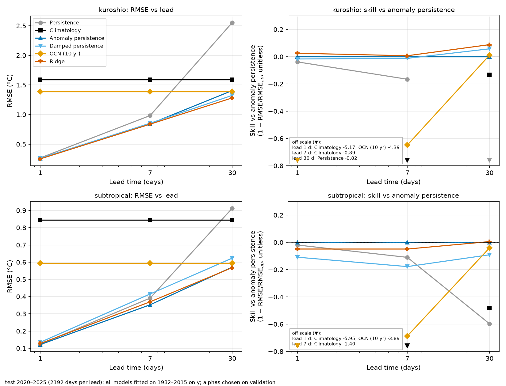

# Simple SST forecast baselines in two North Pacific boxes: a test-period evaluation

**Question.** How hard are simple baselines to beat for 1-, 7- and 30-day SST forecasts, and does a per-grid-point Ridge regression help? This is a baselines study, not an ocean forecasting model.

**Data.** NOAA OISST v2.1 daily 0.25° SST, two 40x40-point boxes (Kuroshio extension, per-point anomaly std 1.13 °C; subtropical, 0.69 °C), 1982-01-01–2025-12-31 (16,071 days). ERDDAP is the primary source; 1,194 days it lacks were filled from NOAA PSL after checks (double fetch, range, step, exact match on overlaps: max |difference| 3.8e-06 °C).

**Protocol.** Training 1982–2015 (climatology: 3 harmonics; Ridge fit), validation 2016–2019 (Ridge alpha), test 2020–2025 (2192 days per lead) evaluated once after a frozen, tagged configuration. Score: cos(lat)-weighted RMSE; skill = 1 − RMSE/RMSE of anomaly persistence.

**Baselines.** persistence; climatology; anomaly persistence; damped persistence (training-year lag correlation); OCN (mean of the same day over the previous 10 years); Ridge (anomaly lags 0–6 and 30-day mean anomaly, one model per grid point and lead).

*Test results: RMSE in °C (skill vs anomaly persistence).*

| Method | kuros. 1 d | kuros. 7 d | kuros. 30 d | subtr. 1 d | subtr. 7 d | subtr. 30 d |
|---|---|---|---|---|---|---|
| Persistence | 0.268 (-0.039) | 0.983 (-0.166) | 2.554 (-0.817) | 0.124 (-0.019) | 0.391 (-0.110) | 0.913 (-0.597) |
| Climatology | 1.591 (-5.174) | 1.591 (-0.886) | 1.591 (-0.132) | 0.846 (-5.955) | 0.846 (-1.399) | 0.846 (-0.480) |
| Anomaly persistence | 0.258 (+0.000) | 0.843 (+0.000) | 1.405 (+0.000) | 0.122 (+0.000) | 0.353 (+0.000) | 0.571 (+0.000) |
| Damped persistence | 0.262 (-0.017) | 0.854 (-0.012) | 1.324 (+0.058) | 0.135 (-0.109) | 0.415 (-0.178) | 0.623 (-0.091) |
| OCN (10 yr) | 1.390 (-4.394) | 1.390 (-0.648) | 1.390 (+0.011) | 0.595 (-3.890) | 0.595 (-0.687) | 0.595 (-0.041) |
| Ridge | 0.251 (+0.025) | 0.838 (+0.007) | 1.281 (+0.088) | 0.128 (-0.049) | 0.370 (-0.049) | 0.568 (+0.006) |

**Key findings.**

1. **Anomaly persistence is the bar to beat, especially at short range.** At 1 day all anomaly-based methods have RMSE of 0.122–0.258 °C (subtropical–Kuroshio, anomaly persistence), while climatology gives 0.846–1.591 °C and OCN 0.595–1.390 °C. Ridge's margin over anomaly persistence at 1 day is small (skill +0.025 Kuroshio, -0.049 subtropical).
2. **Ridge helps in the high-variability Kuroshio box, not reliably in the subtropical box.** Kuroshio: Ridge beats anomaly persistence at every lead (skill +0.025, +0.007, +0.088 at 1, 7, 30 d). Subtropical: Ridge is worse at 1 and 7 days (-0.049, -0.049) and about equal at 30 d (+0.006); on validation it had been better at all leads (+0.022, +0.056, +0.090). The validation advantage did not carry over.
3. **Plain persistence fails at 30 days, and the warm shift hurts climatology-based forecasts.** Persistence at 30 d has skill -0.817 (Kuroshio) and -0.597 (subtropical) relative to anomaly persistence. Against the 1982–2015 climatology the test years are warm: mean bias of the climatology forecast is -0.827 °C (Kuroshio) and -0.656 °C (subtropical); Ridge at 30 d is also biased low (-0.442, -0.287 °C).

**Limitations.** Two small regions; simple statistical baselines; OISST is a smooth interpolated analysis; hybrid ERDDAP + PSL data (verified on overlaps); v2/v2.1 label change at 2016; warm shift vs the 1982–2015 climatology, not detrended; Ridge ignores spatial structure; its alpha sits at the grid's lower edge in several cases; one fixed split.

**Next step.** Optionally a small LSTM under the same protocol (reference: Hao et al. 2025, IEEE Trans. Cybernetics 55(6), review). Code and data checks: `README.md`, `results/*.json`.
